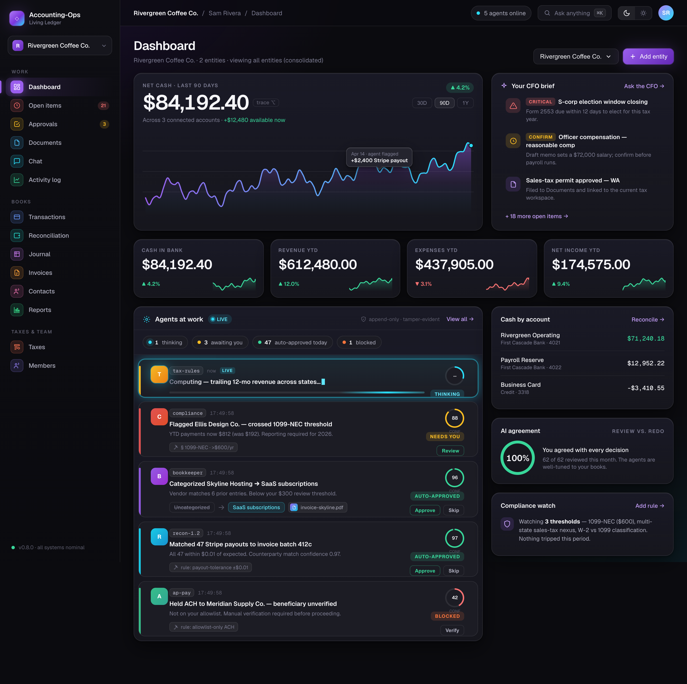
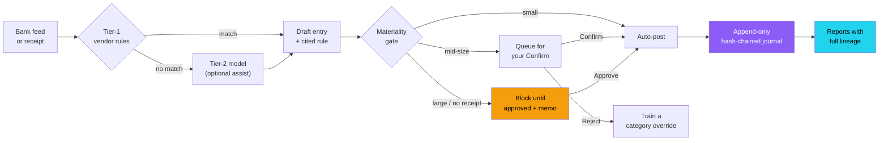
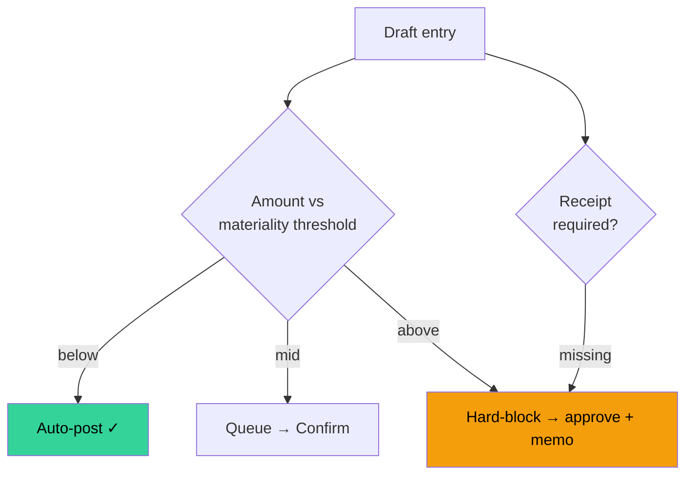
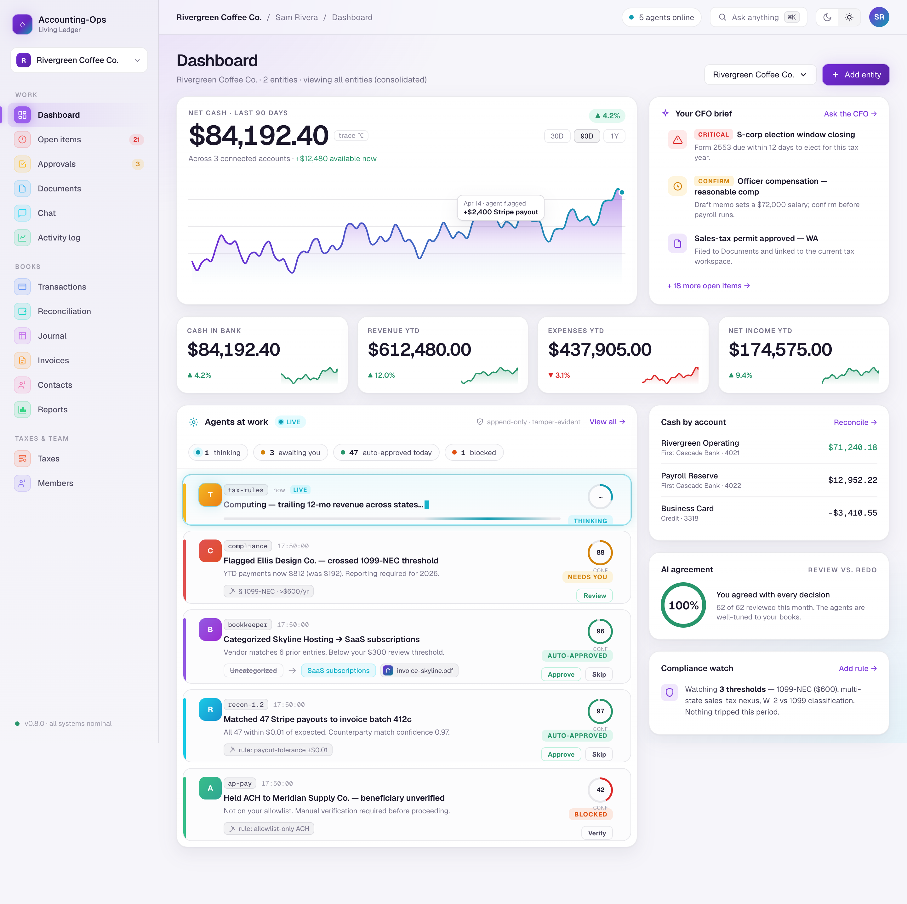
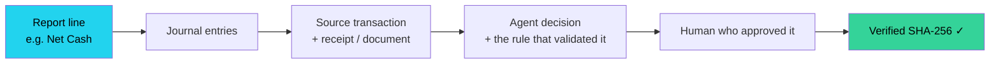
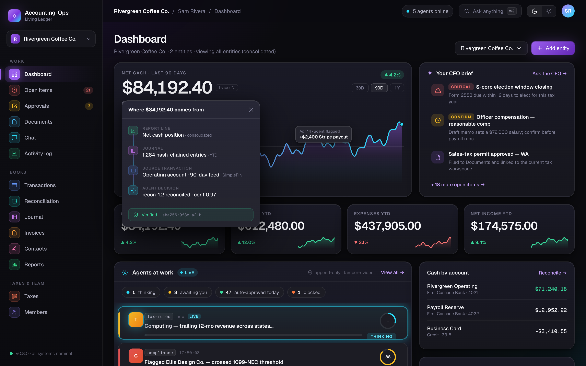
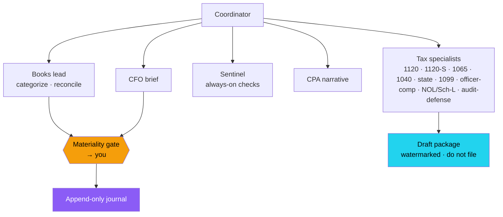
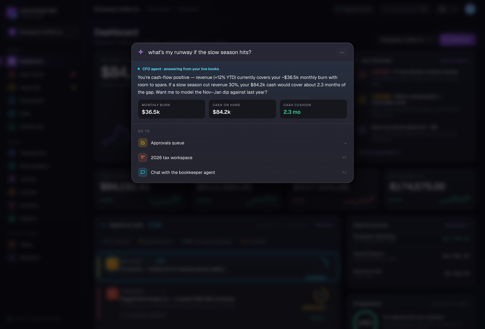
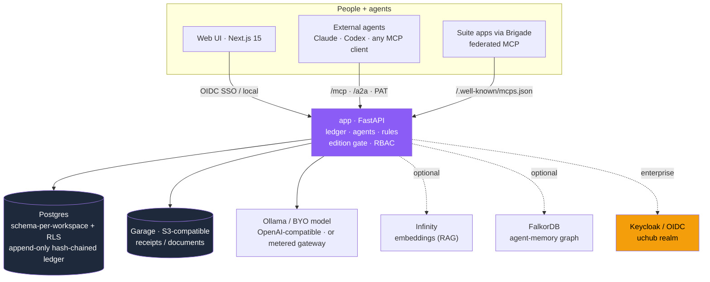
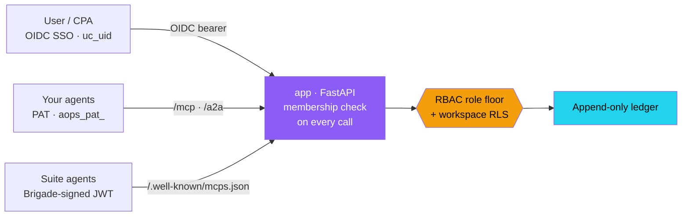

<div align="center">

<h1>Accounting-Ops</h1>

### The first open-source autonomous AI accountant

**Verifiable books. Agents do the work — you keep the authority — every number shows its source.**

Autonomous agents keep your general ledger — categorizing transactions, reconciling receipts,
drafting statements, and assembling tax packages — on an **append-only, hash-chained journal you
can audit line by line**. It runs on **your** hardware with **your** models, from one founder on a
laptop to a CPA firm running SSO across a hundred clients. No mandatory cloud account. No telemetry.
No black boxes in your books.

[](LICENSE)
[](CHANGELOG.md)
[](#quickstart)
[](#identity-auth--agent-access)
[](#identity-auth--agent-access)
[](#security--your-data)
[](#bring-your-own-model)

**[Quickstart](#quickstart)&nbsp; · &nbsp;[How it works](#how-it-works--one-transaction-end-to-end)&nbsp; · &nbsp;[Features](#what-it-does)&nbsp; · &nbsp;[Architecture](#architecture)&nbsp; · &nbsp;[Auth &amp; agents](#identity-auth--agent-access)&nbsp; · &nbsp;[Editions](#editions)&nbsp; · &nbsp;[Who it's for](#who-its-for)&nbsp; · &nbsp;[Disclaimer](DISCLAIMER.md)**

<br/>



<sub><i>Shown on fictional demo data. Your real books never leave your machine.</i></sub>

</div>

---

> [!WARNING]
> **Not tax, legal, or accounting advice.** Accounting-Ops is software, not a licensed
> professional, and using it creates no professional relationship. You alone are responsible
> for anything you file, sign, or pay — verify every figure against your own records and
> consult a qualified CPA/EA/attorney for anything with legal or financial consequence.
> See **[DISCLAIMER.md](DISCLAIMER.md)**.

## Why it exists

Every AI bookkeeping product on the market asks you to ship your general ledger to somebody
else's cloud and trust a model you can't see. Accounting-Ops takes the opposite stance — the four
ideas the rest of this README expands on:

- **🔒 Sovereignty is the default.** Self-host on your own hardware, air-gapped if you need to.
  Your journal, your encryption keys, your egress policy. We never see your books and never will.
- **✍️ Agents draft, you approve.** Nothing posts to your ledger until either a deterministic rule
  clears it or a human signs off. No magic, no surprises — every draft cites its source and its policy.
- **🔗 Audit-defensible by construction.** The ledger is append-only and cryptographically chained.
  Every number traces back to the source document, the agent that drafted it, the rule that
  validated it, and the human who approved it.
- **🧠 Bring your own model.** Point it at a local Ollama, vLLM, an on-prem gateway, or a hosted API.
  The whole categorizer even runs with **no model at all** — Tier 1 is a deterministic rule engine.

We sit *above* the model providers and *below* the human reviewer: the substrate your agents
actually run on when the numbers have to be right.

## How it works — one transaction, end to end

A bank line or a receipt comes in. A **deterministic rule** handles it if it can; a model only
assists on what the rules leave uncertain, and that draft is queued, never silently posted. A
**materiality gate** decides what can auto-post, what needs your *Confirm*, and what is hard-blocked
until you approve it with a memo. Only then does it become an immutable, hash-chained journal entry —
and every report line built on it can be traced right back to this moment.



**The materiality gate** is the safety valve — small auto-categorized items flow through, anything
consequential stops for a human, and money-sensitive categories (travel/meals) block without a
matching receipt:



## What it does

| Surface | What it does |
|---|---|
| **Dashboard** | Net cash + YTD Revenue / Expenses / Net Income from the journal, a CFO brief of what needs you, and a live feed of every agent decision |
| **Transactions** | Unified transaction stream with categorization, per-entity badges, and materiality |
| **Reconciliation** | Human-in-the-loop review — *Confirm* posts to the journal, *Reject* trains a category override |
| **Journal** | Paginated, per-entity SHA-256 verify-chain with double-entry detail, provenance, and reversal lineage |
| **Reports** | P&L / Balance Sheet / Cash Flow with period chips, rendered in-app — no external service |
| **Invoices / AR** | Draft invoices, record payments, and track receivables — every posting lands on the hash-chained ledger |
| **Connectors** | Bank / CSV ingest and connector clients, with credentials encrypted at rest under a local master key |
| **Taxes** | Tax-knowledge Q&A + draft tax-form packages (1120 / 1120-S / 1065 / 1040 / state / 1099), watermarked **draft / do not file** |
| **CPA export** | CSV / IIF / QBO XML / PDF exports for your accountant |
| **Clients** † | Multi-client CPA console — one operator, many workspaces, cleanly isolated |
| **Work inbox** † | Cross-client, read-only queue of every OPEN actionable item across the workspaces you can act in, stalest-first |
| **Chat / ⌘K** | Ask anything over your live books; the agent answers with the numbers *and* their lineage |

<sub>† Multi-client surfaces are mounted only in the firm/enterprise editions (`AO_EDITION`), and are absent — not just hidden — in Community.</sub>

<div align="center">

<br/><sub><i>Light and dark, same product. Fictional demo data.</i></sub>
</div>

### Trace any number back to its source

Click any figure and the provenance chain unrolls — report line → journal entries → source
transaction → the agent decision that reconciled it — ending in a verified `sha256` hash. **If a
fact about your business can't be explained, it can't be posted** (a missing source is an error,
HTTP 422, not a guess).



<div align="center">

</div>

### Append-only journal with a hash chain

Every posted transaction becomes a `journal_entry` row in a per-entity SHA-256 hash chain.
Reversals create *new* entries (never overwrite). `verify_chain` walks the chain from genesis and
reports the first index whose recomputed hash disagrees — i.e. the exact point of any tampering.

```
this_hash = sha256( prev_hash || canonical_payload(entry) )
```

### Categorization is deterministic first

Tier 1 is a **deterministic vendor-rule engine** (`app/categorization/vendor_rules.py`) — fast,
auditable, and it covers the bulk of recurring transactions with **no model call**. A model is
only consulted as an optional Tier-2 fallback for what the rules leave `Uncategorized`, and those
are always queued for review rather than auto-posted. **You can run the whole categorizer with no
model at all.**

### The agents

Specialist agents each own a job and report through a coordinator. They *draft* — the materiality
gate and your approval decide what becomes real. Tax specialists assemble packages that are always
watermarked **draft / do not file**, and a Sentinel runs always-on integrity and freshness checks.



### Ask your books anything

<div align="center">

</div>

---

## Architecture

A legible stack you can run on one box or scale to a firm. The FastAPI app is the system of record;
the web UI and every external agent operate it through the **same** surfaces — there is no shadow API.



This is the **monorepo**: a FastAPI backend (`app/`), a Next.js 15 App-Router frontend (`web/`), the
agent roster (`agents/`), and the migrations + provisioning scripts that stand it all up.

- **MCP-first / agent-first.** The FastAPI app exposes an **MCP** surface (`/mcp`) and an **A2A**
  surface (`/a2a`) so agents operate the ledger the same way the UI does — no wrappers, no shadow API.
- **Deterministic where it matters.** Categorization Tier 1 and the double-entry posting engine
  are rule-based and model-free; models are an optional assist, never the system of record.
- **Optional services degrade gracefully.** Infinity (Tax-Knowledge RAG embeddings) and FalkorDB
  (best-effort agent-memory graph) are both optional — the app runs fully without either.

See **[docs/ARCHITECTURE.md](docs/ARCHITECTURE.md)** for the full runtime picture, data flows, and
the hash-chain spec, and **[docs/AGENT-ACTIVITY-SPEC.md](docs/AGENT-ACTIVITY-SPEC.md)** for the
agent-activity event model.

### Multi-tenancy model — `Workspace > Entity > User`

- **Workspace** — the isolation boundary. Each workspace is a dedicated Postgres schema; a
  workspace-scoped session pins every query to that schema, and under the shared-tenancy prod ring a
  **row-level-security (RLS) fence** backs it (the app connects as a `NOBYPASSRLS` role).
- **Entity** — a legal entity within a workspace (an LLC, an S-corp, a personal 1040). Entities are
  row-scoped within the schema, so consolidated and per-entity views come from the same ledger.
- **User** — the auth subject (`uc_uid`). In Community / local mode this is your single admin;
  RBAC still resolves through the normal membership checks.

---

## Identity, auth & agent access

The same operations are reachable by people and by agents through **one authenticated surface** —
and who you are, and what you may touch, is resolved on **every** call against workspace membership.

- **People — SSO or local.** Enterprise authenticates users through **Keycloak / OIDC** (the
  `uchub` realm); `uc_uid` is the canonical identity across the suite. The Community Edition swaps
  this for a single env-configured local admin (`AO_AUTH_MODE=local`) — no identity provider required.
- **Your agents — Personal Access Tokens.** Mint an owner-scoped PAT (`aops_pat_…`) from
  **Settings → PATs** and point any MCP client at `/mcp`. A PAT can be narrowed to specific workspaces.
- **Internal workers — scoped service tokens.** Long-running workers (e.g. the receipt reconciler)
  act on behalf of a workspace owner via service tokens that can be capped by `workspace_ids`,
  `entity_ids`, and a `role_floor` — least privilege by construction.
- **Suite agents — Brigade federation.** Accounting-Ops publishes a discovery manifest at
  **`/.well-known/mcps.json`** describing its MCP endpoint, tool namespace (`account`), and per-tool
  role floors — generated live from the registered tools, no manual sync. Brigade federates suite
  users into calls with a signed JWT (RS256), verified against Brigade's JWKS and an expected
  audience. `/.well-known/mcp.json` advertises the OIDC endpoints for direct OAuth clients.
- **RBAC.** Roles run viewer → client-user → bookkeeper → accountant / cpa → admin → owner (plus
  client-scoped and platform roles); every MCP tool declares the role floor it requires.



Enterprise-only surfaces (the multi-client console, cross-app federation, and hosted-gateway key
minting) are gated by `AO_EDITION`: with `AO_EDITION=community` they are **not imported or mounted**,
and the community app has no runtime dependency on any of them.

---

## Quickstart

**Prerequisites:** Docker + Docker Compose v2, and (for the bootstrap helper) Python 3.12 and
`openssl` on the host. No GPU required — a CPU-only Ollama works, just slower.

### One command (self-host)

```bash
git clone <this-repo> accounting-ops && cd accounting-ops
make selfhost
```

`make selfhost` (→ `scripts/selfhost_bootstrap.sh`) is idempotent and will:

1. create `.env` from `.env.example`;
2. generate strong secrets (Postgres, Garage, NextAuth) and the `AO_LOCAL_AUTH_SECRET`;
3. set `AO_EDITION=community` + `AO_AUTH_MODE=local`;
4. prompt you for a local admin password and store only its scrypt hash;
5. generate the credential master key (`secrets/accounting_ops_master_key`);
6. build + start the stack — **postgres + garage + ollama + app + web**;
7. run migrations, provision one workspace + entity, grant your admin the owner role, and seed a chart of accounts.

Then open **http://localhost:3000**, sign in with your admin email + password, and you're in.

Pull a vision model so the agent can categorize and read receipts:

```bash
docker compose -f docker-compose.selfhost.yml exec ollama ollama pull qwen2.5vl:7b
```

Add a manual journal entry (or import a bank CSV), open **Reports**, and render a P&L — all with
**no external fleet dependency**.

<details>
<summary><b>Manual setup</b> — what the bootstrap does under the hood</summary>

```bash
cp .env.example .env

# 1. Secrets — a long random value in each. AO_LOCAL_AUTH_SECRET must be the
#    SAME value the web and backend share:
#      POSTGRES_PASSWORD, GARAGE_RPC_SECRET, GARAGE_ADMIN_TOKEN,
#      NEXTAUTH_SECRET, AO_LOCAL_AUTH_SECRET

# 2. Edition + auth mode (already set for community in .env.example if you copy it)
#      AO_EDITION=community
#      AO_AUTH_MODE=local
#      AO_LOCAL_ADMIN_EMAIL=you@example.com
#      AO_LOCAL_ADMIN_UC_UID=admin

# 3. Admin password hash
python scripts/gen_local_admin_hash.py     # paste output into AO_LOCAL_ADMIN_PASSWORD_HASH

# 4. Credential master key
python -m scripts.bootstrap_master_key --path secrets/accounting_ops_master_key

# 5. Up
docker compose -f docker-compose.selfhost.yml up -d --build

# 6. Migrate + provision (inside the app container)
WID=$(python -c 'import uuid;print(uuid.uuid4())')
docker compose -f docker-compose.selfhost.yml exec -T app alembic -c alembic-public.ini upgrade head
docker compose -f docker-compose.selfhost.yml exec -T app python -m scripts.provision_workspace "$WID" "My Company" --entity "My Company:llc"
docker compose -f docker-compose.selfhost.yml exec -T app python -m scripts.grant_workspace_admin "$WID" admin --role owner
docker compose -f docker-compose.selfhost.yml exec -T app python -m scripts.seed_default_coa "$WID" my-company
# then set DEFAULT_WORKSPACE_ID + TENANT_ID to $WID in .env and restart app + web
```

</details>

### Enterprise (SSO + multi-client)

The same image runs the enterprise edition. Set `AO_EDITION=enterprise` and `AO_AUTH_MODE=keycloak`,
point it at your Keycloak (`uchub`) realm, and the multi-client console, cross-client work inbox, and
Brigade federation manifest mount automatically. See **docs/PROD-RING-RUNBOOK.md**
for the tenancy + RLS setup and **docs/HOSTED-TURN-ON.md** for metered,
credit-gated smart inference (deterministic bookkeeping always stays free).

### Bring your own model

The bundled **Ollama** service (`http://ollama:11434/v1`) is the default target for the
categorizer and receipt OCR. Set `LLM_ENDPOINT_URL` / `LLM_MODEL` in `.env` to point anywhere
OpenAI-compatible — a remote Ollama, vLLM, an on-prem gateway, or a hosted API. Choose a **vision**
model for receipt reading.

### Optional services (compose profiles)

| Profile | Service | What it adds | Degrades gracefully? |
|---|---|---|---|
| `embeddings` | Infinity | embedding backend for the Tax-Knowledge RAG index | Yes — app runs fine without it |
| `graph` | FalkorDB | best-effort agent-memory projection | Yes — a no-op if absent |

```bash
docker compose -f docker-compose.selfhost.yml --profile embeddings --profile graph up -d
```

### Demo data (optional)

```bash
make demo    # seeds two generic sample workspaces (no PII)
```

---

## Editions

Accounting-Ops is **open-core**. The AGPL core — ledger, agents, reports, tax drafting — is the same
in every edition; the multi-tenant *suite* surfaces (multi-client console, cross-app federation,
hosted-gateway key minting) live behind the `AO_EDITION` seam and are simply **not mounted** in
Community. The AGPL Community Edition is published as its own repository
([`accounting-ops-community`](https://github.com/Unicorn-Commander/accounting-ops-community)); this
monorepo is the full open-core product.

| | **Community** (AGPL, self-host) | **Hosted** | **Professionals & firms** | **Enterprise** (on-prem) |
|---|:---:|:---:|:---:|:---:|
| Ledger · categorization · reports · CPA export | ✅ | ✅ | ✅ | ✅ |
| Agents (categorize / reconcile / CFO / tax specialists) | ✅ | ✅ | ✅ | ✅ |
| Multi-entity per workspace | ✅ | ✅ | ✅ | ✅ |
| Bring-your-own model | ✅ (Ollama default) | ✅ + BYOK | ✅ | ✅ + shared gateway |
| Managed smart inference (metered credits) | — | ✅ | ✅ | optional |
| Auth | Local single-admin | Hosted accounts | **SSO** (Keycloak/OIDC) | **SSO** (Keycloak/OIDC) |
| Multi-client CPA console + cross-client work inbox | — | — | ✅ | ✅ |
| Suite / Brigade federation (cross-app agents) | — | — | ✅ | ✅ |
| Runs on **your** infrastructure | ✅ | we host | your choice | ✅ on-prem |
| License | AGPL-3.0 | commercial | commercial | commercial |

### What Accounting-Ops does **not** do — by design

Across every edition, these are **off and clearly labeled** — the product drafts *for your records*
and hands the last mile to a licensed human (see [DISCLAIMER.md](DISCLAIMER.md)):

- **No electronic filing.** It generates tax packages *for your own records*; it does **not**
  transmit to the IRS (MeF), a **state portal**, or any authority. Generated tax documents are
  watermarked **draft / "do not file."**
- **No tax payments.** No **EFTPS** connection; it never moves money.
- **No e-signature** submission of filings.
- **No trades, transfers, or payments** are executed on your behalf.

The tax-submission tracker only *records* that you sent a filing (paper / portal / e-file) — it
does not send anything.

---

## How it compares

Most tools in this space make you choose between *someone else runs your books* and *you own a
spreadsheet*. Accounting-Ops is the third option: software you run, that agents operate, that can
prove every number.

| | **Accounting-Ops** | Bookkeeping services<br/>(Pilot, Bench) | Ledgers<br/>(QuickBooks, Xero) | Closed AI SaaS<br/>(Digits, Puzzle, Truewind) | Pipes<br/>(Plaid, Codat) |
|---|:---:|:---:|:---:|:---:|:---:|
| Runs on **your** infrastructure | ✅ | — | — | — | — |
| **Append-only** + hash-chained ledger | ✅ | — | — | — | — |
| **Agent-operable** (MCP / A2A) | ✅ | — | — | partial | — |
| **Federated** agent access (suite / Brigade) | ✅ | — | — | — | — |
| **Bring-your-own** model / runtime | ✅ | — | — | — | n/a |
| Human-approval gates on posting | ✅ | ✅ (their staff) | manual | varies | — |
| Source you can **read and change** | ✅ AGPL | — | — | — | — |
| No data leaves your machine | ✅ | — | — | — | — |

- **Not Pilot or Bench.** Those are bookkeeping *services* with a portal. This is software you run.
- **Not QuickBooks or Xero.** Those are your CPA's tool. This is your *agents'* substrate.
- **Not Digits, Puzzle, or Truewind.** Those are closed SaaS with one model behind a logo. This is
  self-hostable, multi-runtime, and the rules are yours to read.
- **Not Plaid or Codat.** Those are pipes. This is the layer where the pipes turn into a defensible ledger.

---

## Who it's for

- **Founders & small businesses** who want their books *actually kept* — not just a dashboard —
  without handing their financials to a SaaS.
- **Privacy- and sovereignty-minded operators** (regulated, air-gapped, or simply careful) who need
  the ledger and the keys to stay on their own hardware.
- **Accountants & fractional CFOs** who run many clients from one console, want agents to do the
  grind while a human keeps sign-off, and need an audit trail that holds up.
- **Developers & AI builders** who want a real, agent-operable financial backend to build on via
  MCP / A2A, instead of gluing together closed APIs.

---

## Security & your data

- **No telemetry by default.** The OTEL endpoint defaults to none; there is no analytics SDK.
  Nothing about your books leaves the host unless you configure an egress yourself.
- **Authenticated on every call.** People authenticate via Keycloak/OIDC (or a local admin);
  agents via owner-scoped PATs, scoped service tokens, or Brigade-signed JWTs — all resolved against
  workspace membership and an RBAC role floor.
- **Tenant isolation in the schema.** Schema-per-workspace, backed by a row-level-security fence
  under shared tenancy; the runtime DB role is `NOSUPERUSER` / `NOBYPASSRLS` and does not own its
  objects, so the append-only guarantee is enforced by Postgres, not merely by app code.
- **Encrypted credentials.** Connector credentials are encrypted at rest with a local master key
  mounted in the container at `/run/secrets/accounting_ops_master_key`; the key is runtime-only and
  is never baked into the application image. **Back it up out-of-band** — losing it orphans all
  encrypted credentials.
- Found a vulnerability? See **[SECURITY.md](SECURITY.md)**.

## The design stance

Accounting-Ops is built as an **autonomous professional-substitute you supervise** — not a
co-pilot that only suggests, and not a black box that just decides. It never fabricates provenance
(a missing source is an error, HTTP 422, not a guess), it watermarks anything unfiled as *draft*,
and it routes anything it isn't sure about to you. Read the full posture in
**[docs/PROFESSIONAL-SUBSTITUTE.md](docs/PROFESSIONAL-SUBSTITUTE.md)**.

## Contributing

Issues and PRs are welcome. By contributing you agree to the **Developer Certificate of Origin**
(sign your commits with `git commit -s`). Start with **[CONTRIBUTING.md](CONTRIBUTING.md)** and our
**[CODE_OF_CONDUCT.md](CODE_OF_CONDUCT.md)**.

If Accounting-Ops is useful to you, **starring the repo** genuinely helps others find it. ⭐

## License

The open-core is **[GNU AGPL-3.0-or-later](LICENSE)** — you may run, study, share, and modify it; if
you offer it as a network service, your users are entitled to the source of your version. The
enterprise / suite modules held behind the `AO_EDITION` seam ship under a separate commercial
license. See **[NOTICE](NOTICE)**.

<div align="center">
<br/>
<sub><b>Accounting-Ops is not a CPA, EA, tax preparer, attorney, or fiduciary.</b><br/>
It is a tool that helps you do that work — and you are responsible for what you do with it.</sub>
</div>
