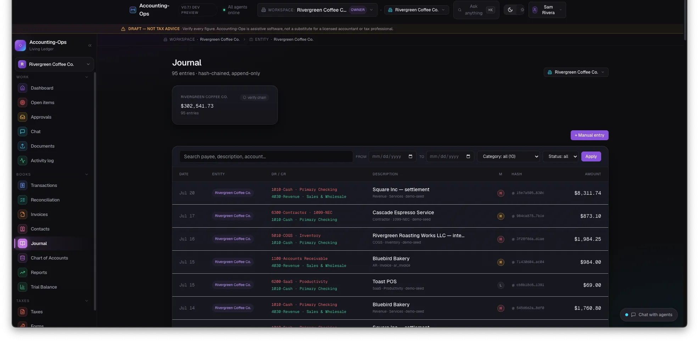
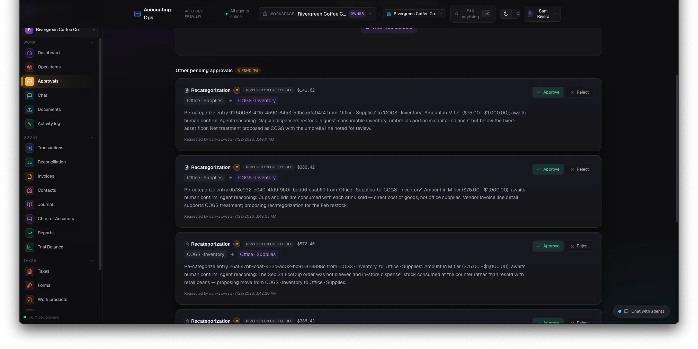
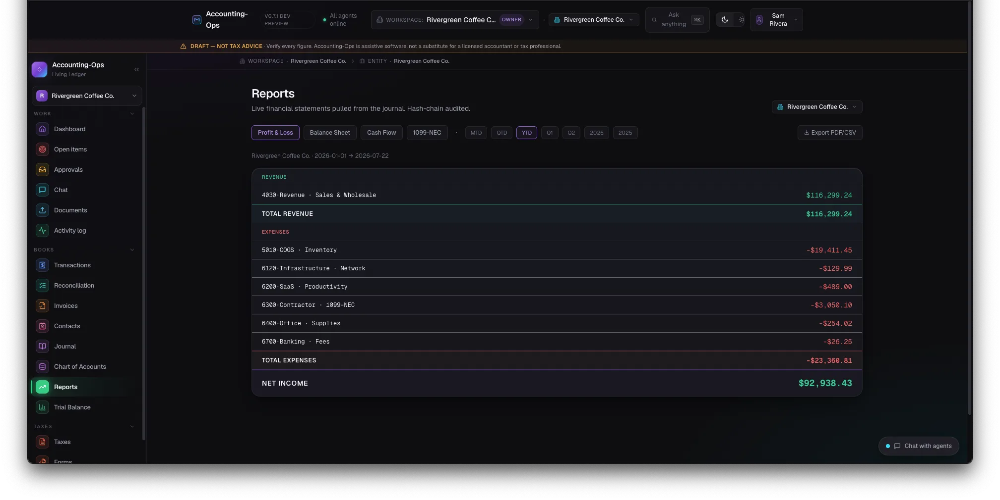
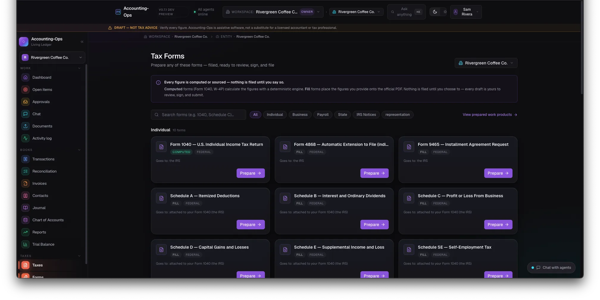
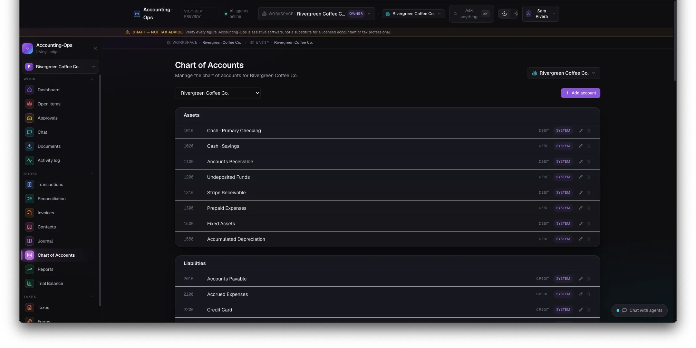
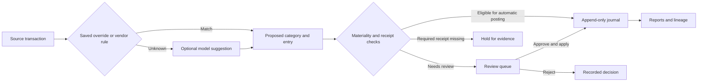
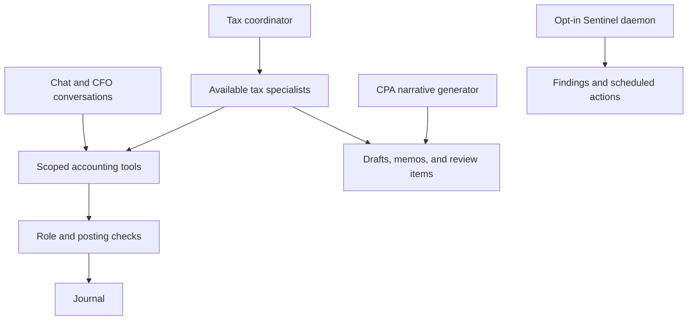
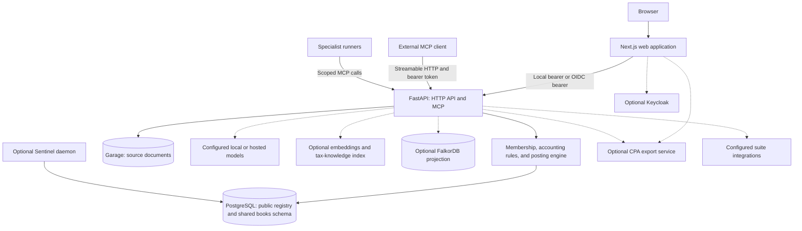

<div align="center">

<h1>Accounting-Ops</h1>

<p><strong>Self-hosted accounting: agents prepare the books, you review the work, and the journal keeps the trail.</strong></p>

[](LICENSE)
[](CHANGELOG.md)
[](pyproject.toml)
[](app/main.py)
[](web/package.json)
[](#quick-start)
[](#built-for-agents)

**[Quick start](#quick-start) · [Features](#feature-tour) · [Agents](#built-for-agents) · [Architecture](#architecture) · [Suite](#part-of-unicorn-commander)**

</div>

<p align="center">
  
</p>
<p align="center"><sub>The dashboard, shown with synthetic demo books. All screenshots below use fictional data.</sub></p>

## What is Accounting-Ops?

Accounting-Ops is an open-source accounting application for business owners, bookkeepers,
accountants, and developers building financial agents. It brings transaction categorization,
review queues, an append-only general ledger, financial reports, invoicing, and tax work products
into a self-hosted workspace. Deterministic rules handle repeatable bookkeeping; agents suggest
categories and prepare drafts, while materiality checks and reviewer decisions govern posting.
It is part of **Unicorn Commander**, with optional connections for shared identity, contacts,
quotes, invoice email drafts, and tax-planning data.

> **Accounting-Ops is software, not professional advice.** Review figures against your records
> and consult a qualified professional before filing, signing, or paying. See [DISCLAIMER.md](DISCLAIMER.md).

## Highlights

- **Follow the evidence.** Trace supported dashboard and report figures to journal entries,
  source references, linked documents, and recorded decisions.
- **Keep the original entry.** A recategorization appends a reversal and a restatement and
  leaves the original entry in place. A per-entity hash chain lets you check the journal for
  broken links or altered hashed fields.
- **Review consequential work.** Materiality and receipt checks stop uncertain postings;
  approval screens show the proposed action and its reasoning before a reviewer applies it.
- **Start with rules.** Vendor rules and saved category overrides work without a model.
  Optional model suggestions remain reviewable rather than becoming automatic classifications.
- **Read the same books in the UI or through MCP.** Reports, transactions, account setup, and
  journal tools use workspace membership and role checks.
- **Prepare the accountant's handoff.** Review specialist drafts, tax forms, and work-product
  provenance; connect the optional CPA export service for accounting-file and report downloads.
- **Choose your deployment and inference.** Local admin login needs no SSO service. Configure
  local or hosted models separately for categorization, chat, and specialist runs.

## Feature tour

### Your books at a glance

The dashboard combines cash position, revenue, expenses, net income, open work, and recent agent
activity. The CFO brief brings attention to findings and pending decisions. Light and dark themes
keep the same navigation and accounting context.

<p align="center">
  
</p>

### Trace a number to its source

Open a supported figure's lineage view to inspect the entries that produced it, their source
references, linked document hashes, and available agent decisions. The view also exposes chain
verification and reversal links. Document and decision detail depends on what the source recorded.

<p align="center">
  
</p>

### An append-only journal

Browse double-entry postings by entity, date, account, and category, then inspect an entry's
reasoning and reversal history. Each chained entry incorporates the previous hash and its own
canonical accounting fields. **Verify chain** checks the stored chain against recomputed hashes.

<p align="center">
  
</p>

### Agent work waiting for your approval

Review proposed imports, recategorizations, rules, and journal postings with their reasoning.
Approving a supported queue item applies its held action and records the decision; rejecting it
leaves that action unapplied. Journal proposals that require human attestation cannot obtain it
from an agent-supplied confirmation flag.

<p align="center">
  
</p>

### Reports from the posted journal

View profit and loss, balance sheet, cash flow, and trial balance by period and entity, and
1099-NEC by calendar year and entity. Built-in reports are served by this application from posted
journal data. The separate **CPA Export** screen offers CSV, IIF, QBO XML, and PDF downloads when
its companion service is configured.

<p align="center">
  
</p>

### Tax forms and work products

Prepare business-return working data, personal-return calculations, form fills, specialist memos,
and selected state work products. Drafts carry a review watermark; work-product watermarks reflect
review or self-attestation status. A populated work-product field with no `source_ref` is refused
with HTTP 422 before it is stored or rendered. A blank value is allowed. IRS and state transmission
are not implemented.

<p align="center">
  
</p>

### Reconciliation starts with the right accounts

Map connected accounts to entities and maintain each entity's chart of accounts. The reconciliation
queue has three columns: needs review (a sign mismatch, or an unmapped entity that is not already
unknown), uncategorized (`category_status` unknown), and auto-categorized (status auto and an
entity mapping). Rejecting an item can save a category override for later imports. The image shows
the chart that underpins posting.

<p align="center">
  
</p>

### Ask your books a question

Open the command palette with **⌘K / Ctrl+K** to navigate or start a CFO conversation in the active
workspace and entity. Cash, burn, and runway cards use the CFO-brief data; responses stream through
the configured chat model and tools. Chat requires its own inference configuration.

<p align="center">
  
</p>

The rest of the working surface is available from the same workspace:

| Surface | Capability and dependency |
|---|---|
| **Transactions and connectors** | Categorization, entity mappings, encrypted connector credentials, native Stripe and eBay reconciliation, and a SimpleFIN client that uses stored credentials. Uploaded CSVs are stored for review; uploading one does not automatically import its transactions. |
| **Invoices and receivables** | Draft and issue invoices, record payments, void with reversing entries, and render invoice PDFs. Optional Stripe Checkout creates customer payment links when configured. |
| **Documents** | Store source files in Garage and extract supported receipt or tax-document information. Uploads need initialized object storage and S3 credentials; model-assisted extraction needs an appropriate model. |
| **Tax knowledge** | Retrieve indexed tax-knowledge documents and rules. Semantic search requires a populated index and an embedding backend. |
| **Tax working data** | Tools for Form 1120, 1120-S, 1065, 1040, and 1099 work. The coordinator marks Form 1120, 1099, the South Carolina state specialist, officer compensation, and NOL/Schedule L available. Audit defense and the payroll advisor are registered as unavailable and produce gap notices. A separate state-strategy drafter writes multi-state memos (South Carolina populated; Georgia, New York, California, Florida, and Texas are scaffolding). Some business-return data tools call the optional CPA export service. |
| **Sentinel** | Opt-in scheduled checks for bookkeeping, deadlines, regulatory-feed freshness, and other findings; per-workspace controls and a global disable switch govern the daemon. |
| **Clients and work inbox** | In enterprise mode, a multi-client console and a read-only cross-client queue bring actionable work together, ordered by age. |

<details>
<summary><strong>How it works: one transaction, from classification to a report</strong></summary>

Saved category overrides take precedence over vendor rules in
[app/categorization/vendor_rules.py](app/categorization/vendor_rules.py). If neither classifies an
item, an optional model may suggest a category. A suggestion does not establish permission to
post: the posting engine also checks materiality, entity mapping, category trust, and required
receipt links.



The [materiality gate](app/journal/materiality.py) uses the absolute transaction amount:

| Condition | Posting behavior |
|---|---|
| Below $75 | Eligible for automatic posting only when the category status is `auto`, the category is not Uncategorized, the entity is mapped, and the transaction direction matches. |
| $75 to below $1,000 | Requires confirmation, even when a vendor rule matched. |
| $1,000 or more | Blocks automatic posting until explicitly confirmed. |
| A receipt-required category without its receipt link | Blocks posting regardless of amount or confirmation. |
| A bookkeeper's proposed write | The posting path requires review rather than allowing that role to auto-post. |

The receipt-required categories are `Travel · Lodging`, `Travel · Transport`, and `Meals`. These are software rules, not
a statement that the software covers every accounting or tax requirement. See the
[posting engine](app/journal/posting.py) and [category engine](app/categorization/engine.py).

Conceptually, the journal chain is:

```text
this_hash = SHA-256(previous_hash || canonical_accounting_fields)
```

[Verification](app/journal/hash_chain.py) reports mismatched hashes and broken predecessor links.
A recategorization appends a reversal and a restatement and leaves the original entry in place.
Voiding an invoice appends reversing entries for the issue rows. A valid chain checks integrity
of the hashed records; reviewers still need to establish that the underlying evidence is correct.

</details>

## Built for agents

The FastAPI application mounts **78 registered MCP tools** at `/mcp` using **stateless
Streamable HTTP**. The mounted transport requires an `Authorization: Bearer` token. Workspace
and entity operations check the caller's membership, role, and token scope; changing an ID in
a tool argument does not grant access to another workspace.

Start with discovery, then use the IDs returned by the server:

| Job | Useful tools |
|---|---|
| Discover accessible books | `list_my_workspaces`, `list_workspace_entities` |
| Read and explain | `list_transactions`, `get_journal_entry`, `get_p_and_l`, `get_balance_sheet`, `get_cash_flow`, `get_runway` |
| Review proposed work | `list_pending_approvals`, `analyze_pending_approvals`, `ai_categorize_pending` |
| Maintain the ledger | `post_journal_entry`, `categorize_transaction`, `verify_journal_chain`, `close_period` |
| Prepare a handoff | `get_period_journal`, `draft_memo`, `flag_for_cpa_review`, `tax_prepare_filing` |
| Track specialist work | `list_specialist_runs`, `get_specialist_run` |

The count is the registered catalog, not a promise that every tool works without prerequisites.
Quote tools require their feature gate, some tax-data tools require CPA Export, and
`propose_payment_tool` remains an unimplemented placeholder. See the
[tool registrations](mcp_server.py) and [implementations](app/tools).

The HTTP decide route for a queued journal-entry proposal (`journal_entry_post`) requires
Keycloak browser-session claims: `sid` or `session_state`, an integer `auth_time` greater than
zero, and `azp` equal to `KEYCLOAK_CLIENT_ID`. It rejects personal access tokens, agents, service
tokens, and machine callers. The local admin token sets `uc_uid` and `scope`, and has no `sid`,
`session_state`, `auth_time`, or `azp`. The MCP
`decide_approval` tool calls that handler without an `AuthContext` argument, so this subject type is refused
with HTTP 403. The local owner's manual journal form still posts: it sets `user_confirmed` on
the journal-entry route, and the owner role is not force-queued.

### Connect an MCP client

Sign in and create a Personal Access Token under **Settings → MCP Access Tokens**
(`/settings/pats`), narrowing its workspace
access and scopes as appropriate. For the Docker quick start, the API is on
`http://localhost:8000/mcp`; the browser UI is on a different port.

For example, put this in your **VS Code user MCP configuration**, replacing the token placeholder
locally. Keep populated credentials out of version control. The fields follow the
[VS Code MCP configuration reference](https://code.visualstudio.com/docs/agents/reference/mcp-configuration).

```json
{
  "servers": {
    "accounting-ops": {
      "type": "http",
      "url": "http://localhost:8000/mcp",
      "headers": {
        "Authorization": "Bearer <personal-access-token>"
      }
    }
  }
}
```

Ask the client to call `list_my_workspaces`, then `list_workspace_entities` for a workspace it
returns. Use a read such as `get_p_and_l` to verify access before enabling write tools. For a
remote deployment, replace the URL with your HTTPS API endpoint.

### Identity and authorization

- **People:** local admin credentials or Keycloak/OIDC, selected by `AO_AUTH_MODE`. The local
  login signs a backend bearer; it is an authentication mode, not an auth bypass.
- **Personal agents:** PATs act as their owner, subject to membership and any scope restrictions.
- **Workers:** service tokens can restrict workspace IDs, entity IDs, and effective role through
  `ACCTOPS_SERVICE_TOKENS`. An agent's configured tool allow-list adds another restriction.
- **Suite agents:** enterprise mode supports Brigade-signed JWTs and publishes a live tool
  catalog at `/.well-known/mcps.json` under the `account` namespace. The simpler
  `/.well-known/mcp.json` document advertises the MCP URL and OIDC metadata.
- **Roles:** viewer, client user, bookkeeper, accountant, admin, and owner are separate ranks.
  CPA matches accountant, and client owner matches owner. `platform_admin` is a platform role.
  See [the role guide](docs/roles.md).

Use the mounted HTTP transport for authenticated clients. Although `mcp_server.py` has a stdio
entry point, it does not supply the request authentication context required by workspace tools.
The discovery document advertises OIDC metadata even in local mode; PAT setup above is the
direct local-client path.

### Specialist runners and other hooks

The repository includes chat personas, a tax coordinator, specialist runners, a CPA narrative
generator, and Sentinel. They serve different workflows rather than forming one always-running
agent tree. The tax coordinator dispatches available specialists and reports missing ones as
gaps; its draft outputs and run records can be inspected in the app.



The tax-page **Run drafts** launcher stays off unless `AO_TAX_RUN_LAUNCH_ENABLED` is `1`,
`true`, `yes`, or `on`. It launches Form 1120, 1099, and SC1120, and only for a C-corporation
entity. It needs `ACCTOPS_SERVICE_TOKEN` registered in `ACCTOPS_SERVICE_TOKENS` (and scoped to
the workspace when that token lists workspace ids) plus the CPA-team model route (`CPATEAM_LLM_*`).
Sentinel is also opt-in. See [tax specialists](agents/tax_specialists/README.md),
[the CPA team](agents/cpa_team/README.md), and [agent activity](docs/AGENT-ACTIVITY-SPEC.md).

**A2A status:** `/a2a/agent-card.json` publishes discovery information, but the `/a2a` handler
only implements `agent/card`; other methods return a placeholder error. `/a2a/stream` emits a
connection event. Use MCP for accounting operations; A2A task execution is not implemented.

## Quick start

**Prerequisites:** Git, Docker with the Compose plugin, and Python **3.12+** on the host.
The self-host stack includes PostgreSQL, Garage, Ollama, the API, and the web app. It uses local
admin login; **Keycloak and the other Unicorn Commander apps are not required**. Basic journal
and report workflows do not require a model or GPU. Initial image builds and model downloads
need network access and can take longer than the configuration steps.

Use the following sequence for a **fresh checkout and new database volumes**. `make selfhost`
runs public-schema migrations, provisions one workspace, grants the admin, and seeds a chart of
accounts. Creating the `books` schema and running `alembic -c alembic-tenant.ini` are the extra
steps in the sequence below. The sequence uses the self-host Compose file's database defaults.

### Prepare local configuration

```bash
git clone https://github.com/Unicorn-Commander/Accounting-Ops.git
cd Accounting-Ops

python3 - <<'PY'
from pathlib import Path
import secrets
import subprocess
import sys
import uuid

path = Path(".env")
if path.exists():
    raise SystemExit(".env already exists; keep it and review your existing setup.")
with open("/dev/tty") as tty:
    print("Local admin email: ", end="", flush=True)
    email = tty.readline().strip()
if not email:
    raise SystemExit("An admin email is required.")
workspace = str(uuid.uuid4())
values = {
    "AO_EDITION": "community",
    "AO_AUTH_MODE": "local",
    "AO_LOCAL_ADMIN_EMAIL": email,
    "AO_LOCAL_ADMIN_UC_UID": "admin",
    "DEFAULT_WORKSPACE_ID": workspace,
    "TENANT_ID": workspace,
}
for name in ("POSTGRES_PASSWORD", "GARAGE_RPC_SECRET", "GARAGE_ADMIN_TOKEN",
             "NEXTAUTH_SECRET", "AO_LOCAL_AUTH_SECRET"):
    values[name] = secrets.token_hex()
values["AO_LOCAL_ADMIN_PASSWORD_HASH"] = subprocess.check_output(
    [sys.executable, "scripts/gen_local_admin_hash.py"], text=True
).strip()
# Let the self-host Compose file supply its single-role database URLs.
replaced = set(values) | {"DATABASE_URL", "ADMIN_DATABASE_URL"}
lines = [line for line in Path(".env.example").read_text().splitlines()
         if line.partition("=")[0] not in replaced]
with path.open("x") as out:
    out.write("\n".join(lines + [f"{k}={v}" for k, v in values.items()]) + "\n")
path.chmod(0o600)
PY

python3 -m scripts.bootstrap_master_key --path secrets/accounting_ops_master_key
```

The password helper prompts without echo and stores a scrypt hash. The master-key helper
refuses to replace an existing key. Back up that key securely alongside your database backups;
encrypted connector credentials cannot be recovered without it.

### Start, migrate, and provision

Run these in the same shell from the repository root:

```bash
dc() { docker compose -f docker-compose.selfhost.yml "$@"; }
dc up -d --build --wait

dc exec -T app alembic -c alembic-public.ini upgrade head
dc exec -T postgres sh -c \
  'psql -v ON_ERROR_STOP=1 -U "$POSTGRES_USER" -d "$POSTGRES_DB" -c "CREATE SCHEMA IF NOT EXISTS books"'

# The first workspace must exist before the later balance-rebuild migration.
dc exec -T app alembic -c alembic-tenant.ini -x tenant=books upgrade 0029_entity_owner
dc exec -T app sh -c \
  'python -m scripts.provision_workspace "$DEFAULT_WORKSPACE_ID" "My Company" --entity "My Company:llc"'
dc exec -T app alembic -c alembic-tenant.ini -x tenant=books upgrade head

dc exec -T app sh -c \
  'python -m scripts.grant_workspace_admin "$DEFAULT_WORKSPACE_ID" "$AO_LOCAL_ADMIN_UC_UID" --role owner'
dc exec -T app sh -c \
  'python -m scripts.seed_default_coa "$DEFAULT_WORKSPACE_ID" my-company'
```

Open **[http://localhost:3000](http://localhost:3000)** and log in with the email and password you
entered. Select **My Company**, inspect its chart of accounts, add a manual journal entry, and
open **Reports**. The migration order follows the repository's
[integration bootstrap](scripts/integration_env.py); the intermediate revision is intentional.

The published ports bind to loopback by default. This is a local evaluation setup using the
owner database role. Configure a least-privilege runtime role, TLS, and backup procedures before
using it as a shared deployment; see [Security](#security).

Useful lifecycle commands:

```bash
make selfhost-logs
make selfhost-down
make selfhost-up
```

`selfhost-down` stops the stack without deleting its named volumes. `make demo` additionally
seeds two generic workspaces, Test Workspace 1 and Test Workspace 2, each with sample entities.
It leaves their journals empty and does not grant your admin access to those workspaces. It does
not reproduce the screenshot books.

### Enable the capabilities you need

**Model-assisted categorization and receipt reading.** Pull the model named by the bundled
configuration, then use a supported workflow that invokes it:

```bash
docker compose -f docker-compose.selfhost.yml exec ollama ollama pull qwen2.5vl:7b
```

`LLM_ENDPOINT_URL`, `LLM_MODEL`, and `LLM_API_KEY` configure the receipt/vision route.
`CATEGORIZER_LLM_*` can select a separate text model; blank categorizer settings inherit the
vision route. `CATEGORIZER_FALLBACK_*` enables optional escalation. The deterministic category
engine can operate without either model.

**Chat and specialist inference are separate.** Configure `AO_CHAT_LOCAL_BASE_URL`,
`AO_CHAT_LOCAL_MODEL`, and `AO_CHAT_LOCAL_DEFAULT` for a local chat route, or configure a hosted
provider/BYOK path. Specialist runners use `CPATEAM_LLM_*`. Pulling the receipt model alone does
not configure CFO chat or tax specialists. Model requests send their prompts and tool context
to the provider you select; see inference and billing.

**Documents and form templates.** Garage needs its node layout, bucket, and S3 access configured
before uploads work. Blank S3 credentials leave uploads disabled. Official PDF templates are
not tracked: [download_irs_forms.sh](scripts/download_irs_forms.sh) and
[download_scdor_forms.sh](scripts/download_scdor_forms.sh) fetch them. Run those helpers before
rebuilding the API image if you want the templates included in it.

**Optional self-host profiles:**

| Profile | Component | Purpose |
|---|---|---|
| `embeddings` | Infinity | Embeddings for the tax-knowledge index; enable and populate the index for semantic retrieval. |
| `graph` | FalkorDB | Optional agent-memory projection and learned-pattern hints; PostgreSQL remains authoritative. |
| `sentinel` | Sentinel | Scheduled workspace checks; review its workspace settings before enabling. |

For example, to add the embedding and graph services:

```bash
docker compose -f docker-compose.selfhost.yml --profile embeddings --profile graph up -d
```

The suite Compose file also defines optional `connectors`, `receipts`, and
`exports` profiles. Those profiles build sibling repositories: SimpleFIN and eBay finance MCP
servers, a receipt worker and reconciler, and the CPA export service. Those components are not
included in this checkout or the self-host stack. Its SSO and reverse-proxy configuration also
assumes external services; use it as a deployment reference rather than a standalone quick start.

## Run from source

Complete the Docker setup above first, then keep its database, storage, and optional models
running while replacing the API and web containers with development processes. You also need
**uv**, **Node.js**, and **npm**. Native PDF rendering requires the system libraries used in the
[API Dockerfile](Dockerfile).

```bash
docker compose -f docker-compose.selfhost.yml stop app web
uv sync --frozen --extra dev --extra tax-agents
npm --prefix web ci
```

Generate ignored development environment files from the resolved Compose configuration. This
keeps the generated credentials and local-login settings together while replacing container
addresses with host addresses. Existing development files are left untouched.

```bash
python3 - <<'PY'
from pathlib import Path
import json
import subprocess

config = json.loads(subprocess.check_output(
    ["docker", "compose", "-f", "docker-compose.selfhost.yml", "config", "--format", "json"],
    text=True,
))
for service, filename in (("app", ".env.backend.local"), ("web", "web/.env.local")):
    path = Path(filename)
    if path.exists():
        raise SystemExit(f"Keep and review the existing {filename} before continuing.")
    env = dict(config["services"][service]["environment"])
    for key, value in env.items():
        env[key] = str(value or "").replace("@postgres:", "@localhost:") \
            .replace("http://garage:", "http://localhost:") \
            .replace("http://ollama:", "http://localhost:") \
            .replace("http://infinity:", "http://localhost:") \
            .replace("http://app:", "http://localhost:")
    env["FALKORDB_HOST"] = "localhost"
    env["ACCTOPS_MASTER_KEY_PATH"] = str(Path("secrets/accounting_ops_master_key").resolve())
    env["DRAFTS_DIR"] = str(Path("drafts").resolve())
    with path.open("x") as out:
        out.write("\n".join(f"{k}={json.dumps(v)}" for k, v in env.items()) + "\n")
    path.chmod(0o600)
PY
```

Start the API from the repository root:

```bash
uv run --frozen --extra dev --extra tax-agents \
  uvicorn app.main:app --env-file .env.backend.local --reload --host 127.0.0.1 --port 8000
```

In another terminal, start the web app from the same repository root:

```bash
npm --prefix web run dev
```

The web app reads `web/.env.local` and reaches the API through `INTERNAL_API_BASE_URL`.
Visit **http://localhost:3000**. Do not run these development servers as public production services.

## Configuration

[.env.example](.env.example) documents deployment settings. Its defaults select the suite's
enterprise/Keycloak path; the quick start explicitly selects Community/local login. The table
lists variable names and their purpose; supply credentials through your own environment files
or secret management.

| Variable(s) | Meaning |
|---|---|
| `AO_EDITION` | Controls Community versus enterprise application surfaces. |
| `AO_AUTH_MODE` | Selects local admin login or Keycloak/OIDC authentication. |
| `AO_LOCAL_ADMIN_EMAIL`, `AO_LOCAL_ADMIN_UC_UID` | Local administrator login and canonical identity. |
| `AO_LOCAL_ADMIN_PASSWORD_HASH`, `AO_LOCAL_AUTH_SECRET` | Password verifier and shared web/API signing secret for local login. |
| `NEXTAUTH_URL`, `NEXTAUTH_SECRET`, `PUBLIC_BASE_URL` | Browser-facing URL, session secret, and advertised public application URL. |
| `KEYCLOAK_REALM_URL`, `KEYCLOAK_CLIENT_ID`, `KEYCLOAK_CLIENT_SECRET` | OIDC realm and application credentials for SSO deployments. |
| `POSTGRES_DB`, `POSTGRES_USER`, `POSTGRES_PASSWORD` | Database initialization settings. |
| `DATABASE_URL`, `ADMIN_DATABASE_URL`, `APP_DB_PASSWORD` | Runtime and migration connections, plus the restricted runtime role's password. |
| `TENANT_ID` | Default workspace fallback used by local tooling and application context. |
| `GARAGE_S3_ENDPOINT`, `GARAGE_BUCKET_PREFIX`, `GARAGE_S3_REGION` | Object-storage endpoint, bucket naming, and signing region. |
| `GARAGE_S3_ACCESS_KEY`, `GARAGE_S3_SECRET_KEY` | Storage credentials required by document uploads. |
| `GARAGE_RPC_SECRET`, `GARAGE_ADMIN_TOKEN` | Garage node and administration credentials. |
| `DOCUMENT_UPLOAD_MAX_BYTES` | Maximum accepted document-upload size. |
| `LLM_ENDPOINT_URL`, `LLM_MODEL`, `LLM_API_KEY` | Receipt/vision inference endpoint, model, and optional credential. |
| `CATEGORIZER_LLM_ENDPOINT_URL`, `CATEGORIZER_LLM_MODEL`, `CATEGORIZER_LLM_API_KEY`, `CATEGORIZER_LLM_TIMEOUT_S` | Independent text-categorizer route and timeout. |
| `CATEGORIZER_FALLBACK_ENDPOINT_URL`, `CATEGORIZER_FALLBACK_MODEL`, `CATEGORIZER_FALLBACK_API_KEY`, `CATEGORIZER_ESCALATE_BELOW_CONFIDENCE` | Optional categorizer escalation and its confidence threshold. |
| `LLM_FALLBACK_BASE_URL`, `LLM_FALLBACK_MODEL`, `LLM_FALLBACK_API_KEY` | Optional fallback provider for supported inference failures. |
| `AO_CHAT_LOCAL_BASE_URL`, `AO_CHAT_LOCAL_MODEL`, `AO_CHAT_LOCAL_API_KEY`, `AO_CHAT_LOCAL_DEFAULT` | Local chat routing and whether it is the instance default. |
| `AO_CHAT_ESCALATE_HARD_PERSONAS` | Whether selected chat personas escalate from the local route. |
| `OPENROUTER_API_KEY`, `ANTHROPIC_API_KEY` | Credentials for the corresponding hosted-model paths. |
| `AO_ROUTE_CHAT_THROUGH_GATEWAY`, `LLM_GATEWAY_BASE_URL`, `LLM_GATEWAY_ADMIN_KEY`, `LLM_PLATFORM_VIRTUAL_KEY` | Optional gateway routing and workspace-key management. |
| `AO_SMART_GATE_ENABLED` | Optional enterprise entitlement gate for hosted inference. |
| `EMBED_BASE_URL`, `EMBED_MODEL`, `INFINITY_DEVICE` | Tax-knowledge embedding provider, model, and local device selection. |
| `FALKORDB_HOST`, `FALKORDB_PORT` | Optional agent-memory graph connection. |
| `SMTP_HOST`, `SMTP_PORT`, `SMTP_USERNAME`, `SMTP_PASSWORD`, `SMTP_FROM`, `SMTP_USE_TLS` | Outbound mail configuration used by the mailer and outbox drainer. |
| `AO_RATE_LIMIT_ENABLED`, `AO_RATE_LIMIT_REDIS_URL` | Request-limiter switch and optional shared rate-limit backend. |
| `SENTINEL_DEFAULT_INTERVAL_MINUTES`, `SENTINEL_CADENCE_GRACE_MINUTES` | Sentinel polling cadence and check scheduling tolerance. |
| `QUOTES_ENABLED`, `ACCTOPS_TRUSTED_M2M_CALLERS` | Accepted-quote feature gate and trusted machine callers. |
| `AO_TAX_RUN_LAUNCH_ENABLED`, `ACCTOPS_SERVICE_TOKEN`, `CPATEAM_LLM_ENDPOINT_URL`, `CPATEAM_LLM_MODEL`, `CPATEAM_LLM_API_KEY` | Tax-run launcher, worker identity, and specialist inference route. |
| `OTEL_EXPORTER_OTLP_ENDPOINT`, `OTEL_SERVICE_NAME` | Optional trace export and service identification. |

### Editions

**This repository contains the application used by both modes.** Community is selected with
`AO_EDITION=community`; it is not a separate repository or a reduced source checkout.
`AO_EDITION=enterprise` enables the suite-facing surfaces. The backend checks for the Community
value explicitly; use the documented values rather than inventing edition names. Both the API
and web process must receive the setting.

`AO_AUTH_MODE` is independent of the edition flag. The self-host Compose file explicitly sets
Community/local mode for the API and web services, so changing only `.env` does not turn that
Compose file into an enterprise deployment.

| Capability | Community mode | Enterprise mode |
|---|---|---|
| Ledger, categorization, reports, invoices, tax work products | Included | Included |
| Multiple entities within a workspace | Included | Included |
| Direct MCP and owner-scoped PATs | Included | Included |
| Local or hosted model configuration | Available | Available |
| Local admin or Keycloak authentication | Selected independently with `AO_AUTH_MODE` | Selected independently with `AO_AUTH_MODE` |
| Multi-client console and cross-client work inbox | API routers not mounted; navigation hidden | Mounted, subject to permissions |
| Brigade discovery (`/.well-known/mcps.json`) and Brigade client startup | Not mounted and not started | Available when configured |
| Tax-Planning document-extraction read | Mounted. A workspace member uses normal membership. A trusted machine caller is capped at viewer and is refused on a HIPAA workspace. Returns transcribed fields and classification metadata. Serves no document bytes. | Same as Community |
| Contact-Ops pull | Refused with HTTP 503 | Available when Contact-Ops is configured |
| Hosted smart-inference entitlement gate | Exempt | Optional; requires explicit configuration |
| Source license in this repository | Apache-2.0 | Apache-2.0 |

Hosted, professional, and on-premises deployments are deployment choices, not additional
`AO_EDITION` enum values. Feature flags do not provision Keycloak, register OAuth clients, start
external services, or establish a hosted-service agreement. Deployment background is in
DEPLOY.md, the production runbook, and
hosted inference setup.

<details>
<summary><strong>Tax review, filing, signatures, and payments: current boundaries</strong></summary>

Specialist draft PDFs carry the page watermark `DRAFT — CPA REVIEW REQUIRED` and a disclaimer
that begins `DRAFT — CPA REVIEW REQUIRED.` The response header is
`DRAFT - for CPA review only. Do not file without professional review and signature.`
Draft form fills stamp a diagonal `DRAFT` and the banner
`DRAFT — CPA review required — do not file as-is`. Work products start as drafts. Self-attestation
switches the form-fill overlay to
`Prepared via self-certification — review carefully before you sign and submit`
and drops the diagonal DRAFT stamp. Reviewed or finalized work-product states (`pro_reviewed`,
`finalized`) render with no watermark. Review status is not proof of legal or financial correctness.

A populated work-product field with no `source_ref` is refused with HTTP 422 on create and on PDF
render. A blank value is allowed.

The app can prepare filing artifacts and record externally submitted filings, but the live
IRS/state e-file transmitter and outbound submission rails remain gated stubs. It does not
submit tax returns or initiate tax payments. The MCP payment-proposal tool is also a placeholder.

Document signatures are a separate workflow: a manual provider is available and a configured
Docuseal provider can request signatures. Customer invoice payment links can use configured
Stripe Checkout. These features do not turn the tax-submission tracker into a filing service.
See [DISCLAIMER.md](DISCLAIMER.md) and the [design posture](docs/PROFESSIONAL-SUBSTITUTE.md).

</details>

## Architecture



- **[app/](app)** owns authentication, workspace resolution, HTTP routes, tool implementations,
  posting rules, document handling, and tax work products.
- **[web/](web)** is a Next.js App Router frontend. Server-side API requests attach the logged-in
  user's bearer; browser sessions are managed by NextAuth.
- **[agents/](agents)** contains the chat runtime, specialist orchestration, narrative generation,
  and Sentinel. Worker processes and model routes are configured separately.
- **[migrations/](migrations)** maintains the public registry and the shared accounting schema;
  **[scripts/](scripts)** provides provisioning, seeding, connector sync, and operational helpers.
- **PostgreSQL** is authoritative. Garage holds source files, while FalkorDB is an optional
  projection whose availability must not determine whether ledger writes succeed.

### Workspace → Entity → User

A **workspace** is the authorization and data-isolation boundary. At HEAD, accounting rows live
in a shared PostgreSQL schema named `books`; each request sets the workspace context for its
transaction. `FORCE ROW LEVEL SECURITY` policies use that context, and application checks enforce
entity scopes. The older schema-per-workspace design survives in historical tooling and docs.

An **entity** is a legal entity inside a workspace. Its chart, postings, and hash chain support
per-entity reporting; authorized users can also access consolidated views. A **user** is the
canonical `uc_uid` identity with workspace memberships and roles. Local login uses the configured
admin identity and the same membership resolution.

Database role selection matters: shared deployments should use the restricted runtime role,
not the owner/superuser connection used by the introductory self-host recipe. See
[workspace sessions](app/workspace_session.py), [tenancy](app/tenancy.py), and
the consolidation runbook. The
[architecture notes](docs/ARCHITECTURE.md) and workspace/entity/user guide
provide design background; the shared-schema runtime described here supersedes their older
schema-per-workspace examples.

## Part of Unicorn Commander

| App | What it does |
|---|---|
| [Ops-Center](https://github.com/Unicorn-Commander/Ops-Center) | The control plane: tenants, billing, federation, API keys, model routing |
| [Unicorn-Brigade](https://github.com/Unicorn-Commander/Unicorn-Brigade) | The agent layer: agents, tools, memory, orchestration |
| [Unicorn-Stable](https://github.com/Unicorn-Commander/Unicorn-Stable) | Humans and agents in the same room: chat, voice, video |
| **[Accounting-Ops](https://github.com/Unicorn-Commander/Accounting-Ops)** | **Agent-native accounting and books** |
| [Contact-Ops](https://github.com/Unicorn-Commander/Contact-Ops) | The shared contact and identity graph |
| [Customer-Ops](https://github.com/Unicorn-Commander/Customer-Ops) | Customers, pipeline, quotes and outreach |
| [Email-Ops](https://github.com/Unicorn-Commander/Email-Ops) | Agent-drafted email with a human approval inbox |
| [Project-Ops](https://github.com/Unicorn-Commander/Project-Ops) | Projects, tasks, time and invoices |
| [Meeting-Ops](https://github.com/Unicorn-Commander/Meeting-Ops) | Recordings, transcripts, summaries and action items |
| [Knowledge-Ops](https://github.com/Unicorn-Commander/Knowledge-Ops) | The wiki and memory your agents ground on |
| [Security-Ops](https://github.com/Unicorn-Commander/Security-Ops) | Authorized security scanning with engagement and attestation gates |
| [Tax-Planning-Ops](https://github.com/Unicorn-Commander/Tax-Planning-Ops) | Tax plans, scenarios and statutory deadlines |
| [Brand-Ops](https://github.com/Unicorn-Commander/Brand-Ops) | Brand kits, marks, voices and rules |
| [Podcast-Ops](https://github.com/Unicorn-Commander/Podcast-Ops) | Episodes, audio QA and publishing |
| [UUDA](https://github.com/Unicorn-Commander/UUDA) | The device agent for your fleet |
| [fleet-map](https://github.com/Unicorn-Commander/fleet-map) | Fleet inventory and topology map |

Enterprise mode can use Ops-Center organization and billing hooks, Brigade MCP federation, and
Contact-Ops contact pulls when those services are configured. Customer-Ops accepted quotes and
Email-Ops invoice drafts are optional seams in this tree. The Tax-Planning document-extraction
read is mounted in both editions. It accepts a workspace member or a trusted machine caller and
returns transcribed fields and classification metadata. It serves no document bytes.

## Development

Install the development dependencies as described in [Run from source](#run-from-source).
CI's unit job installs with `pip install -e ".[dev]"`, then runs `ruff check tests scripts` as a
blocking lint and `pytest -v` (the same invocation as `make test`). Integration tests in that job
skip themselves when no stack is reachable. `ruff check app` is informational there (`|| true`).
`make test-fast` is the local smoke-and-unit subset.

```bash
make test-fast PY=.venv/bin/python
uv run --frozen --extra dev ruff check tests scripts
```

The `uv` lint line is a local equivalent of CI's blocking `ruff check tests scripts`. CI also runs
`uv lock --check` and `bash scripts/download_irs_forms.sh` before the tests.

The repository also exposes the following test workflows:

| Command | Purpose |
|---|---|
| `make test-collect PY=.venv/bin/python` | Collect the configured Python suite without running it. |
| `make test PY=.venv/bin/python` | Run the full suite; integration tests can write to a reachable test stack. |
| `make integration PY=.venv/bin/python` | Build a disposable Compose integration stack, run its tests, and tear it down. Requires Docker. |
| `make integration-keep PY=.venv/bin/python` | Keep that disposable stack running for investigation. |
| `make integration-down PY=.venv/bin/python` | Remove the integration stack using its harness. |
| `uv run --frozen --extra dev ruff check app` | Local application lint. CI runs `ruff check app || true` and does not fail the job on it. |

The CI integration job runs on pull requests and on `main`, and only when the repository variable `ACCTOPS_INTEGRATION_CI` equals `true`. When it runs, it executes `tests/integration/test_db_rls_roles.py` through the integration harness. `make integration` runs the broader `tests/integration` selection marked `integration`.

Frontend checks, after `npm --prefix web ci`:

```bash
npm --prefix web run test:smoke
npm --prefix web run test:journal-review
npm --prefix web run build
```

Read [CONTRIBUTING.md](CONTRIBUTING.md) and [CODE_OF_CONDUCT.md](CODE_OF_CONDUCT.md) before opening
a pull request. Contributions use the Developer Certificate of Origin; add the required sign-off
with `git commit -s`. Use synthetic data in examples and tests. Release history is maintained in
[CHANGELOG.md](CHANGELOG.md). `pyproject.toml`, `web/package.json`, and the FastAPI `version` in
[app/main.py](app/main.py) are `0.8.0`. The latest released CHANGELOG heading is `0.7.1`
(2026-06-16). Later changes are listed under `Unreleased`.

## Security

Report vulnerabilities privately to **security@magicunicorn.tech** following
[SECURITY.md](SECURITY.md). Include reproduction steps and affected versions; keep credentials
and financial records out of public issues.

- **Credential encryption:** connector secrets are encrypted using a runtime master key mounted
  at `/run/secrets/accounting_ops_master_key`. Keep its backup separate from the encrypted records.
- **Access control:** authenticated accounting routes and MCP tools resolve identity and
  workspace permissions. Discovery, health checks, signed callbacks, and public invoice links
  have their own access models; they are not all login-protected endpoints.
- **Database enforcement:** restricted runtime roles and row policies support tenant isolation
  and append-only permissions. A database superuser can bypass these controls; the quick-start
  owner's connection is not a hardened multi-tenant deployment.
- **Data destinations:** OpenTelemetry exports only when an endpoint is configured. Models,
  connectors, mail, regulatory feeds, and other enabled integrations can make network requests;
  review their configuration when deciding where your data may go.

DEPLOY.md covers operational setup, and data rights describes
export and erasure behavior. This README's local setup is an evaluation path, not a promise of
air-gapped operation or a production security certification.

## Licence

Accounting-Ops is licensed under the [Apache License 2.0](LICENSE). You can use, change and redistribute it, including commercially, under its terms. Our names and logos are covered by [TRADEMARKS.md](TRADEMARKS.md). PyMuPDF is a dependency with its own licence (AGPL-3.0); using it brings its terms.

Built by [Magic Unicorn](https://magicunicorn.tech) · part of [Unicorn Commander](https://unicorncommander.ai)
